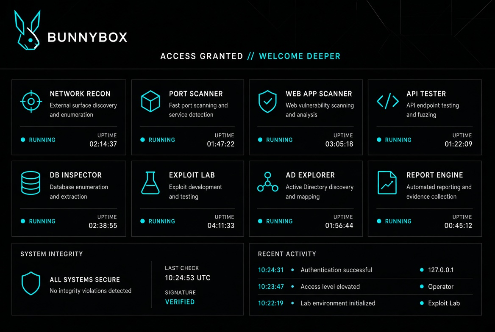

# BunnyBox Launcher

> **Dark minimal homelab launcher for dtrh.net infrastructure**  
> Pure Black + Cyan aesthetic • Down the rabbit hole 🐰



---

## Overview

BunnyBox is a self-hosted launcher/dashboard for the dtrh.net homelab. It provides a clean, dark-themed entry point to all services routed through Cloudflare Tunnel (`app.dtrh.net`) and local access (`bunnybox.local`).

### Current Services

| Service | URL | Category | Status |
|---------|-----|----------|--------|
| **Pentest Harness** | `https://app.dtrh.net/pentest/` | Offensive | 🟢 Running |
| **Yunohost SSO** | `https://app.dtrh.net/yunohost` | Core | 🟢 Running |
| **Cloudflare Access** | `https://dtrhnet.cloudflareaccess.com` | Network | 🟢 Running |
| **BunnyBox Local** | `https://bunnybox.local` | Core | 🟢 Running |
| **Vault** | `https://app.dtrh.net/vault` | Security | 🔒 Locked |
| **Monitoring** | `https://app.dtrh.net/monitoring` | Observability | 🟢 Running |
| **Exploit Lab** | `https://lab.dtrh.net` | Offensive | 🟢 Running |

---

## Quick Start

```bash
# Serve locally (any static server)
cd bunnybox-launcher
python3 -m http.server 8080
# Or: npx serve .
# Or: php -S localhost:8080

# Open http://localhost:8080
```

### Deploy to GitHub Pages / Netlify / Vercel

1. Push this repo to GitHub
2. Enable Pages (or connect to Netlify/Vercel)
3. Set custom domain: `bunnybox.dtrh.net` (or `launcher.dtrh.net`)
4. Configure Cloudflare Tunnel ingress for the new subdomain

---

## Project Structure

```
bunnybox-launcher/
├── index.html              # Main launcher page
├── manifest.json           # PWA manifest
├── README.md               # This file
├── CHANGELOG.md            # Version history
├── css/
│   └── bunnybox.css        # Full theme (CSS custom properties)
├── js/
│   └── launcher.js         # App rendering, search, clock, activity
├── assets/
│   ├── icons/              # SVG icons (cyan #00F0FF)
│   │   ├── icon-pentest.svg
│   │   ├── icon-lab.svg
│   │   ├── icon-vault.svg
│   │   ├── icon-tunnel.svg
│   │   ├── icon-monitoring.svg
│   │   ├── icon-core.svg
│   │   ├── icon-rabbit.svg
│   │   └── icon-settings.svg
│   ├── logo/
│   │   ├── bunnybox-logo.jpg       # Original high-res
│   │   ├── bunnybox-logo-512.png
│   │   ├── bunnybox-logo-192.png
│   │   ├── bunnybox-logo-64.png
│   │   └── bunnybox-logo-32.png    # Favicon
│   └── images/
│       └── launcher.jpg            # Preview screenshot
```

---

## Customization

### Adding a New Service

Edit `js/launcher.js` — add an entry to the `APPS` array:

```javascript
{
  id: 'my-service',
  title: 'My Service',
  desc: 'Description shown on the card',
  url: 'https://app.dtrh.net/my-service',
  icon: 'icon-monitoring.svg',  // or add new SVG to assets/icons/
  status: 'running',             // running | locked | idle | warning
  uptime: 'Live',                // displayed in card meta
  category: 'observability'      // for future filtering
}
```

### Color Theme

All colors are CSS custom properties in `css/bunnybox.css`:

```css
:root {
  --bb-bg:            #050505;        /* Page background */
  --bb-bg-card:       #0d0d0d;        /* Card surface */
  --bb-cyan:          #00F0FF;        /* Primary accent */
  --bb-white:         #ffffff;        /* Headings */
  --bb-text:          #e0e0e0;        /* Body text */
  --bb-text-muted:    #888888;        /* Secondary text */
  --bb-border:        rgba(0,240,255,0.18);
  --bb-radius:        10px;
  --bb-transition:    180ms cubic-bezier(0.4, 0, 0.2, 1);
  --bb-font:          'Inter', system-ui, sans-serif;
  --bb-mono:          'JetBrains Mono', ui-monospace, monospace;
}
```

### Keyboard Shortcuts

| Key | Action |
|-----|--------|
| `/` | Focus search |
| `Esc` | Clear search & blur |
| `Enter` / `Space` | Activate focused card |

---

## Infrastructure Integration

This launcher is designed to work with the dtrh.net homelab setup:

- **Cloudflare Tunnel** (`app-dtrh`, ID: `c7ec7205-d780-4715-bb05-a15149dcffd3`)
  - `app.dtrh.net/pentest/*` → `localhost:8081` (nginx path-strip) → `localhost:8080` (Pentest Harness)
  - `app.dtrh.net` → `localhost:8083` (nginx redirect to Yunohost SSO)
  - `bunnybox.dtrh.net` → `localhost:8082` (nginx redirect to Cloudflare Access)

- **Cloudflare Access** bypass policies for:
  - `bunnybox.dtrh.net` (redirect)
  - `app.dtrh.net/pentest` (Pentest Harness)
  - `app.dtrh.net` (root)

- **Local DNS**: `bunnybox.local` via mDNS/Avahi

---

## Browser Support

- Chrome/Edge 90+
- Firefox 88+
- Safari 14+
- Mobile browsers (PWA installable)

---

## License

MIT — Use freely for your own homelab.

---

## Changelog

See [CHANGELOG.md](CHANGELOG.md) for version history.